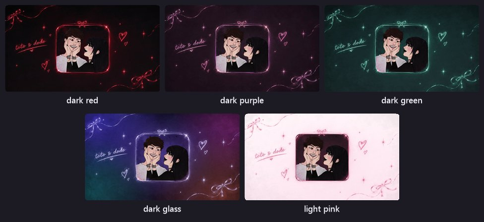
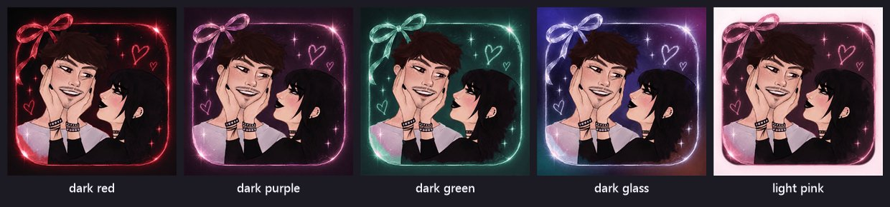

<div align="center">


# ˚₊‧ TOTO & DODO ‧₊˚

**our very own little social media app ♡**
a safe place for us to love, share, and have fun.

<a href="https://noturv0id.github.io/TOTO-DODO/"></a>
&nbsp;

&nbsp;


<br />


</div>

<br />

## ⋆˚✿˖° what's inside

| | |
|---|---|
| 📖 **entries** | our diary: words, photos, songs and stickers, with likes and comments |
| 💬 **comments & replies** | threads like tiktok / instagram, with likes, @mentions and *view replies* |
| 📌 **widgets** | pin it photos, now playing, smol note, important dates, wishlist, weather, poems |
| 🖼️ **photo editor** | pin it has its own editor: crop, rotate, flip, straighten, filters, drawing, and words in four fonts you can drag anywhere |
| 🥺 **i miss you** | one tap to tell the other person, with a counter that keeps score |
| 💞 **together for** | how many days we've had (and counting) |
| 🔔 **notifications** | on our phones for entries, comments, replies, likes, stickers and more |
| 🎨 **themes** | five looks, each with its own launch screen and icon |
| ☁️ **everywhere** | everything is saved online: entries, widgets, the theme, drafts, what you've already seen, recent gifs, so every phone and computer opens the same |
| 📱 **an app** | add it to your home screen and it opens like a real app, even offline |
| 🏝️ **our island** | the whole diary as a little 3D world: walk, ride the scooter or a unicorn together, pet the kitties, bake at dodo’s bakery, paint, take photos together, watch things together, and see each other when you’re both online |

<br />

## ˚₊‧ themes ‧₊˚

<div align="center">

**dark glass (the main one) · dark red · dark purple · dark green · light pink**


<br /><br />



<br /><br />



</div>

<br />

## 🏝️ the 3D island

The diary opens on the classic site; the **3D** button in the header opens the island (and **2D** goes back). On a phone (upright or sideways) the header folds into the ☰ button.

| | |
|---|---|
| 🚶 **walking around** | phone: left thumb to walk, drag to look, pinch to zoom · computer: WASD / arrows, mouse to look |
| ✦ **opening things** | walk up to anything that sparkles; on a phone the round button shows what you’re next to (📸, 🛵, 🐾…) |
| 🗺️ **map** | tap the map to jump to any place |
| 🏠 **the places** | every room is dressed as what it keeps (a book-roofed diary, a gift box, a camera, a music box, a pencil, a clock tower, an ink bottle, a tent, a paint pot), with matching wallpaper, ceilings and furniture inside, and every room has its own floor (piano keys, notebook paper, wrapping paper, a calendar grid…) and a rug shaped for it (a record, a heart, a clock, a bow…) |
| 🧁 **dodo’s bakery** | a big pink, black and neon-green bakery with cat ears on the roof: bake cinnamon rolls, cookies, pie, cake or muffins in a five-step game (gather, mix, shape, set the oven and bake, then decorate with frosting styles, up to three toppings and a message piped on top), hand what you made to your person and watch them eat it, fill the display case, serve the little cat and bunny customers for coins, redesign the whole place on the design board, and write your own menu on the chalk sign outside; all saved for both of us |
| 🎢 **sky coaster** | a pastel rollercoaster on the island’s edge: a chain lift, a huge drop off the island, a loop, a climbing helix. It waits in the station until someone hops in, then you ride it together; switch between your seat, behind the train and from the side |
| 🍿 **our watchlist** | a sign by the cinema with what we post in our now-showing Discord channel (posters and overviews), live |
| 🔥 **cosy spots** | a wishing well, a movie night cinema with a fur carpet, a campfire with toasting marshmallows, and a proper football pitch |
| 🦄 **riding** | the scooter, or a unicorn you can summon and ride together (your person hops on behind); you lean into the turns, and a parked scooter puts itself away after a little while |
| ⋯ **the menu** | camera, scooter, unicorn, pet, chat, voice, invites, music, day / night and how to play, all in one list |
| 👗 **your look** | build your avatar in tabs: style, face, hair, outfit and extras, with any colour you like |
| 🐾 **your pet** | a kitty, a bunny or both: name them, pick a size, colours and a hat |
| 🎮 **games** | bonk-a-mole, catch the bunnies, the ball, the sky race, floating hearts, the sky trail and the baking game |
| 📷 **photos & album** | poses, a timer for photos together, and a wall to keep them |
| 🎨 **painting** | canvases on the island, saved for both of us |
| 💌 **visitors** | a time-limited link so a friend can look around (they can’t open or change anything); an ended link never opens |
| ☁️ **same everywhere** | your look, pet, paintings, album, the bakery, scores, music and day / night are saved online, so phone and computer match |

<br />

## 📲 add it to your phone

- **iphone:** open the diary in safari → share → *add to home screen*, then open it from there and turn on notifications under 🔔 → settings
- **android:** open it in chrome → ⋮ → *install app* (or *add to home screen*)
- the island works sideways too, laid out like the computer so nothing overlaps

<br />

## 🗂️ what's in this repo

This repo is the **live website** that GitHub Pages serves.

```
TOTO-DODO/
├── index.html            the diary
├── assets/               the app's code, styles and themes (hashed so updates show up right away)
├── themes/               launch screens + icons for each theme (glass is the main one)
├── icons/                app icons
├── cursors/              custom cursors
├── anniversary-wrapper.html  a little gift page
├── site.webmanifest      makes it installable
├── sw.js                 lets it work offline + shows notifications
└── readme/               pictures for this page
```

<br />

<div align="center">

### made with love by

**[noturv0id](https://github.com/noturv0id)** · coder / stylist / funder
&nbsp;&nbsp;♡&nbsp;&nbsp;
**[7xb7](https://github.com/7xb7)** · coder / thinker box

<sub>✦ forever and always ✦</sub>

</div>
